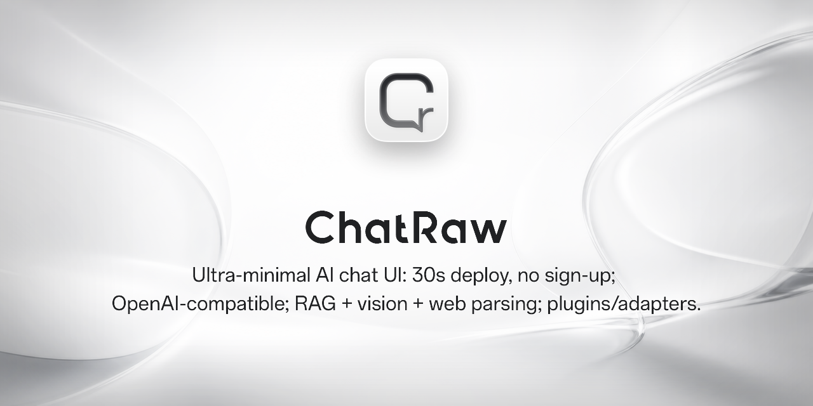
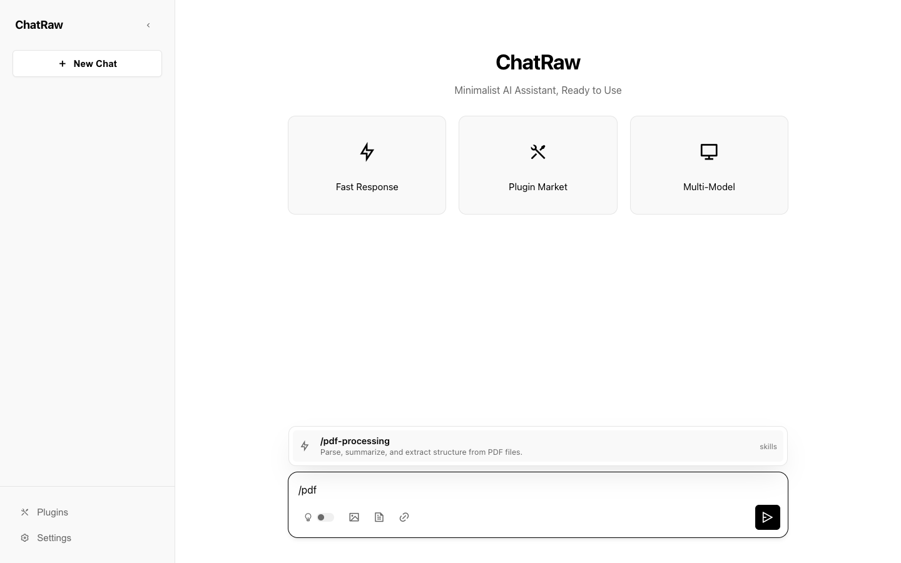

<div align="center">



**Lightweight AI Chat Interface with Plugin System | 轻量 AI 聊天界面与插件系统**

*Fast, Lightweight, Extensible | 快速、轻量、可扩展*


[English](#english) | [中文](#中文)

</div>

---

# English

## Interface Preview

### Main Chat Interface


### Model Configuration


### Plugin Market


---

## Why ChatRaw?

Many developers, AI hardware vendors, and users just need a simple, lightweight application that can quickly demonstrate their model capabilities. That's why we created ChatRaw - a minimal, ready-to-use chat interface that deploys in seconds. No complex configuration, no heavy dependencies—just a clean, fast AI chat experience.

---

## ChatRaw for Mac

ChatRaw now includes a native macOS desktop version: **ChatRaw for Mac**. It wraps the same lightweight web interface in a SwiftUI + WKWebView desktop shell, automatically starts a local ChatRaw backend, and loads the app through a local `127.0.0.1` address. The Mac app provides model settings, plugins, document parsing, image understanding, and support for OpenAI-compatible APIs.

The Mac download that accompanies ChatRaw 2.3 is the original `ChatRaw-for-Mac-2.2.1.dmg` from the v2.2.1 release. It targets Apple Silicon and requires macOS 14 or later. For native Agent setup in the Linux edition, see the [deployment guide](deploy/README.md).

---

## Part 1: Core Features

*Fast, Lightweight, Convenient*

### Core Highlights

- **Native macOS App** - ChatRaw for Mac provides a desktop shell with automatic local backend startup
- **Ultra Lightweight** - ~60MB memory footprint, optimized binary embedding storage
- **Instant Startup** - Ready in seconds with connection pooling for fast API calls
- **Custom Branding** - Freely customize name, logo, and theme
- **Universal API Support** - Works with any OpenAI-compatible API (Ollama, vLLM, LocalAI, LM Studio, etc.)
- **Document Parsing** - Native PDF, DOCX, TXT, MD parsing as chat context
- **Vision AI Ready** - Multimodal image understanding with auto-compression when the chat model's Vision capability is enabled
- **Thinking Mode** - Support for reasoning models (DeepSeek-R1, Qwen, o1, etc.)
- **Mobile Layout** - Touch-friendly controls, a scrollable landscape sidebar, and an input area that adapts to the on-screen keyboard
- **Streaming Replies** - Text appears with a soft reveal while Markdown renders as the response arrives
- **Local UI Assets** - Core interface resources and supported plugin libraries are bundled locally
- **Browser Compatibility** - Tested on Chromium 109, Firefox, and Safari on iPhone 15 Pro
- **One-Click Copy** - Copy AI responses instantly (text only, no metadata)
- **Bilingual UI** - English & Chinese with one-click switch
- **Zero Registration** - Settings auto-saved locally
- **Docker Deployment** - Start ordinary chat with Docker or use the interactive Linux installer for the host Runner

### Key Features

**Multi-Model Configuration**
- Configure multiple chat, embedding, and reranking models
- Built-in endpoint validation and testing

**Thinking Mode**
- Deep reasoning for supported models
- Collapsible thought process display

**Custom Branding**
- Customize interface: name, Logo, subtitle, avatar, and theme colors

**Document & Image Support**
- Upload documents (PDF, DOCX, TXT, MD) as chat context. AI can read and reference document content
- Attach images for multimodal understanding. Automatically compressed to WebP format (~2MB)

---

## Part 2: Extension Plugins

*Flexible, Free, Community-Driven*

ChatRaw features a complete **plugin system** to extend functionality:

### Official Plugins

- **Lightweight RAG Demo** — Knowledge base retrieval
- **Bocha Search** — Web / AI search
- **Tavily Search** — Web search with AI answers
- **Excel Parser Pro** — Parse .xlsx/.xls for chat
- **CSV Parser** — Parse CSV/TSV for chat
- **Enhanced Web Parsing** — Parse web pages (browser / Firecrawl / Jina)
- **Multi-Model Manager** — Manage and switch models
- **Markdown Renderer Plus** — Math (KaTeX), Mermaid, code copy, offline
- **Mindmap Renderer** — Turn outlines and Markmap blocks into interactive mind maps
- **Enhanced Export** — Save replies as TXT, Markdown, PDF, or HTML
- **Voice Input** — Dictate messages in browsers that support speech recognition
- **Context Compressor** — Compact ordinary chat history automatically or from the input toolbar
- **Skill Manager** — Install Agent Skills from GitHub or local files and activate them inline with `/skill-name`
- **Hermes, Codex CLI, Claude Code, Pi, DeepSeek Harness** — Five independent Agent plugins with native sessions, a shared interface for task details, questions, approvals, and stopping tasks, plus persistent workspaces
- **Toolbar Extension Demo** — Demo plugin showcasing UI Extension API

### Toolbar Extension
> Plugins can add custom buttons to the input toolbar with active/loading states, overflow menu for many buttons, and fullscreen modal for complex interactions.

### Plugin Development
- Complete development documentation
- Rich hook system (including new UI Extension API)
- Custom settings UI
- One-click packaging and distribution

**Plugin Development Guide**: [Plugins/README.md](Plugins/README.md)

### Use native Agents

Install and enable the Agent plugins you need, configure each one in its settings, then select one from the chat mode menu beside the message box. Each chat uses one Agent and retains its native session. The Agent manages its own context, instructions, Skills, and compaction; ChatRaw sends the current input and supported attachments. Tasks can continue after you close the page. Use **Stop** to request cancellation.

For native Agents, run ChatRaw in Docker and install the Runner on the same Linux host. Install the Agent programs you need under an account the Runner can use. The native Hermes plugin replaces the former Hermes Router. Configure its Gateway and start a new Agent chat. See the [deployment guide](deploy/README.md) and [Hermes migration guide](docs/hermes.md).

---

## Performance

> **Note**: Performance tests conducted using Google Lighthouse on localhost deployment

|                    Desktop                    |                    Mobile                    |
| :-------------------------------------------: | :------------------------------------------: |
|     ![Desktop Performance][perf-desktop]      |     ![Mobile Performance][perf-mobile]       |
| [Lighthouse Report][perf-desktop-report]   | [Lighthouse Report][perf-mobile-report]   |

**Desktop**: Performance 100 | Accessibility 100 | Best Practices 100 | SEO 100

**Mobile**: Performance 96 | Accessibility 93 | Best Practices 100 | SEO 100

[perf-desktop]: assets/lighthouse-desktop.png
[perf-mobile]: assets/lighthouse-mobile.png
[perf-desktop-report]: https://htmlpreview.github.io/?https://github.com/massif-01/ChatRaw/blob/main/docs/lighthouse/desktop.html
[perf-mobile-report]: https://htmlpreview.github.io/?https://github.com/massif-01/ChatRaw/blob/main/docs/lighthouse/mobile.html

---

## Quick Start

> **Using native Agents?** Follow the [deployment guide](deploy/README.md) to install the host Runner on a new machine or connect your existing Agents.

### Option 1: Docker (Recommended)

**Prerequisites**: [Docker](https://docs.docker.com/get-docker/) installed.

Images are published to **Docker Hub**. Pull `massif01/chatraw:latest` for the current release or `massif01/chatraw:2.3` for this version.

**Supported platforms**: linux/amd64 (Intel/AMD), linux/arm64 (Apple Silicon, Raspberry Pi 4/5).

---

#### Method A: `docker run` (no project files)

Run these commands in a terminal. Data is stored in a Docker volume `chatraw-data`.

```bash
# 1. Pull the latest image (run this again whenever you want to update)
docker pull massif01/chatraw:latest

# 2. Start the container (creates volume chatraw-data if needed)
docker run -d -p 51111:51111 -v chatraw-data:/app/data --name chatraw massif01/chatraw:latest
```

- **Access**: http://localhost:51111  
- **To access LAN services** (e.g. local LLM at 192.168.x.x), use host network instead:
  ```bash
  docker run -d --network host -v chatraw-data:/app/data -e PORT=51111 --name chatraw massif01/chatraw:latest
  ```

---

#### Method B: docker-compose (host network, good for LAN)

Clone the project and run from the repo root. The included `docker-compose.yml` uses host network so the app can reach LAN services (e.g. 192.168.x.x) without extra config.

```bash
# 1. Clone the repository
git clone https://github.com/massif-01/ChatRaw.git
cd ChatRaw

# 2. Pull the latest image and start the service
docker compose pull
docker compose up -d
```

- **Access**: http://localhost:51111 (or http://\<your-ip\>:51111 from other devices).

---

### Option 2: macOS Desktop App

**Requirements**: Apple Silicon Mac, macOS 14+

Download the latest `ChatRaw-for-Mac-*.dmg` from [Releases](https://github.com/massif-01/ChatRaw/releases), open it, and drag **ChatRaw for Mac.app** into Applications.

The macOS app starts the local backend automatically and opens ChatRaw in a native desktop window. Your data is stored under the app's local Application Support directory instead of a Docker volume.

For local development:

**Development requirements**: Xcode Command Line Tools or SwiftPM, plus Python 3.11+

```bash
# Clone repository
git clone https://github.com/massif-01/ChatRaw.git
cd ChatRaw

# Build and run the macOS app
./script/build_and_run.sh
```

---

### Option 3: From Source

**Requirements**: Python 3.12+

```bash
# Clone repository
git clone https://github.com/massif-01/ChatRaw.git
cd ChatRaw/backend

# Install dependencies
pip install -r requirements.txt

# Run
python main.py
```

**Access**: http://localhost:51111

---

## Docker image sources

| Source | Pull command |
|--------|----------------|
| Docker Hub | `docker pull massif01/chatraw:latest` |
| Docker Hub (2.3) | `docker pull massif01/chatraw:2.3` |

---

## Update Guide

### Docker (docker run)

For a deployment with a host Runner, follow the [update and backup instructions](deploy/REFERENCE.md#maintenance).

```bash
# Stop and remove the current container
docker stop chatraw && docker rm chatraw

# Pull the latest image (important: otherwise the old image is reused)
docker pull massif01/chatraw:latest

# Start again (same volume keeps your data)
docker run -d -p 51111:51111 -v chatraw-data:/app/data --name chatraw massif01/chatraw:latest
```

### Docker Compose

```bash
cd ChatRaw
git pull origin main
docker compose pull
docker compose up -d
```

### macOS Desktop App

Download the latest `ChatRaw-for-Mac-*.dmg` from [Releases](https://github.com/massif-01/ChatRaw/releases), replace the old app in Applications, and launch it again. Existing local app data is preserved in Application Support.

### From Source

```bash
cd ChatRaw
git pull origin main
cd backend
pip install -r requirements.txt --upgrade
python main.py
```

### Important changes in v2.0.0 (if upgrading from v1.x)

- RAG is now a plugin: install **Lightweight RAG Demo** from Plugin Market if you need it.
- Default theme is light (changeable in Settings).
- Chat history and settings are preserved.

---

## Configuration

### Initial Setup

1. Open http://localhost:51111
2. Click the **Settings** button in the bottom-left corner
3. Go to **Model Settings**
4. Add your API configuration:
   - API Base URL (e.g., `https://api.openai.com/v1`)
   - Model ID (e.g., `gpt-4`)
   - API Key
5. Click **Verify** to test the connection
6. Click **Save**

### Custom Branding

In **Settings** → **Interface**, you can customize:
- Application name and logo
- User and AI avatars
- Theme mode (light/dark)

### Install Plugins

1. Click the **Plugins** button in the bottom-left corner
2. Browse the **Plugin Market** tab
3. Click **Install** on any plugin
4. After installation, enable the plugin in the **Installed** tab

In ordinary chat, enable **Context Compressor** to use compacted history in model requests. The
`autoCompress` setting creates or updates summaries automatically; when it is off, existing summaries are
still used and you can click the input toolbar compression button to compact manually.

### Use Skills in ordinary chat

Install and enable **Skill Manager** to manage Skills for ordinary chat. You can install skills from a GitHub
repository URL, `owner/repo` shorthand, raw/blob `SKILL.md`, public tree URL, or upload a local
`SKILL.md` / `.zip` package. GitHub repository roots are accepted when ChatRaw can resolve exactly one
skill, such as a root `SKILL.md` or a single `skills/<name>/SKILL.md`; repositories with multiple skills
require a specific tree URL.

Activate skills by typing `/skill-name` directly in the composer. Known skill tokens are highlighted
inline, Backspace/Delete removes a whole skill token at once, and each request can activate up to five
distinct skills. The suggestions menu keeps at most five rows visible and scrolls when there are more
matches. You can also type a clear command such as `install this skill <GitHub URL>` to install a GitHub
skill from chat.



Skills are third-party instruction content. ChatRaw does not execute skill `scripts/`, does not grant
permissions from `allowed-tools`, and treats `trusted` as metadata only. For GitHub installs, ChatRaw
records `license` from `SKILL.md` frontmatter or the repository license API when available; `compatibility`
metadata is not stored or displayed. See the full guide:
[docs/skills.md](docs/skills.md).

---

## Use Cases

- **Developers**: Quickly test and demo your AI models
- **AI Hardware Vendors**: Showcase device capabilities with a ready-to-use interface
- **Researchers**: Experiment with RAG, embeddings, and reranking
- **Students**: Learn AI applications hands-on
- **Enterprises**: Internal AI tools and knowledge bases

---

## Contributing

Contributions are welcome! Please submit issues or pull requests.

### Development Guidelines

1. Fork this repository
2. Create your feature branch (`git checkout -b feature/AmazingFeature`)
3. Commit your changes (`git commit -m 'Add some AmazingFeature'`)
4. Push to the branch (`git push origin feature/AmazingFeature`)
5. Open a Pull Request

---

## License

MIT License

© 2026 ChatRaw by massif-01

---

## Links

- **GitHub**: https://github.com/massif-01/ChatRaw
- **Docker Hub**: https://hub.docker.com/r/massif01/chatraw
- **Plugin Development**: [Plugins/README.md](Plugins/README.md)
- **Issue Tracker**: https://github.com/massif-01/ChatRaw/issues

---

<br><br>

---

<br><br>

# 中文

## 界面展示

### 主聊天界面


### 模型配置


### 插件市场


---

## 为什么选择 ChatRaw？

很多开发者、AI 硬件厂商，甚至是用户只需要一个简洁轻量，能够快速展示自己模型使用的应用，于是我们提供了极简、开箱即用的聊天界面，秒级部署。无需复杂配置，无重型依赖——只需一个干净、快速的 AI 聊天体验。

---

## ChatRaw for Mac

ChatRaw 现在提供原生 macOS 桌面版本：**ChatRaw for Mac**。它使用 SwiftUI + WKWebView 桌面外壳承载同一套轻量 Web 界面，并自动启动本地 ChatRaw 后端，通过本机 `127.0.0.1` 地址加载应用。Mac 应用支持模型配置、插件、文档解析、图片理解和 OpenAI 兼容 API。

ChatRaw 2.3 随附 v2.2.1 发布中的原版 `ChatRaw-for-Mac-2.2.1.dmg`。安装包面向 Apple Silicon，要求 macOS 14 或更高版本。Linux 版的原生 Agent 配置请参阅[部署指南](deploy/README.md)。

---

## 第一部分：核心功能

*快速、轻量、便捷*

### 核心亮点

- **原生 macOS 应用** - ChatRaw for Mac 提供桌面外壳，并自动启动本地后端
- **极致轻量** - 内存占用约 60MB，优化的二进制向量存储
- **极速启动** - 秒级启动，连接池加速 API 调用
- **自定义品牌** - 自由定制名称、Logo 和主题
- **通用 API 支持** - 兼容任意 OpenAI 兼容 API（Ollama、vLLM、LocalAI、LM Studio 等）
- **文档解析** - 原生支持 PDF、DOCX、TXT、MD 解析作为聊天上下文
- **视觉 AI 就绪** - 在聊天模型启用“视觉”能力后支持多模态图片理解和自动压缩
- **思考模式** - 支持推理模型（DeepSeek-R1、Qwen、o1 等）
- **手机适配** - 支持触控、横屏侧栏滚动，输入区随软键盘调整
- **流式回复** - 新文字柔和显现，Markdown 随回复增量渲染
- **界面资源本地化** - 核心界面资源和受支持的插件库随应用提供
- **浏览器兼容** - 已验证 Chromium 109、Firefox 和 iPhone 15 Pro 上的 Safari
- **一键复制** - 一键复制 AI 回复内容（纯文本，不含元数据）
- **双语界面** - 中英文一键切换
- **零注册** - 设置本地自动保存
- **Docker 部署** - 普通聊天可用 Docker 启动，Linux 宿主 Runner 提供交互式安装

### 主要功能

**多模型配置**
- 可配置多个聊天、嵌入和重排模型
- 内置端点验证和测试

**思考模式**
- 为支持的模型启用深度推理
- 可折叠的思考过程显示

**自定义品牌**
- 自定义界面：名称、Logo、副标题、头像和主题颜色

**文档与图片支持**
- 上传文档（PDF、DOCX、TXT、MD）作为聊天上下文。AI 可以阅读和引用文档内容
- 附加图片进行多模态理解。自动压缩为 WebP 格式（约 2MB）

---

## 第二部分：扩展插件

*灵活、自由、社区驱动*

ChatRaw 拥有完整的**插件系统**以扩展功能：

### 官方插件

- **轻量 RAG 演示** — 知识库检索
- **博查搜索** — Web / AI 搜索
- **Tavily 搜索** — Web 搜索 + AI 答案
- **Excel 增强解析器** — 解析 .xlsx/.xls 供对话使用
- **CSV 解析器** — 解析 CSV/TSV 供对话使用
- **增强网页解析** — 解析网页（浏览器 / Firecrawl / Jina）
- **多模型管理** — 管理并切换模型
- **Markdown 渲染增强** — 数学公式、Mermaid、代码复制，离线可用
- **思维导图渲染** — 将大纲或 Markmap 代码块渲染为交互式思维导图
- **增强导出** — 将回复保存为 TXT、Markdown、PDF 或 HTML
- **语音输入** — 在支持语音识别的浏览器中口述消息
- **上下文压缩** — 自动或通过输入框工具栏压缩普通聊天的历史
- **Skill 管理器** — 从 GitHub 或本地文件安装 Agent Skills，并用 `/skill-name` 在输入框内联激活
- **Hermes、Codex CLI、Claude Code、Pi、DeepSeek Harness** — 五个独立 Agent 插件，保留原生会话，可查看任务详情、回答问题、处理审批和停止任务，并保留工作目录
- **工具栏扩展演示** — 展示 UI 扩展 API 的演示插件

### 工具栏扩展
> 插件可以在输入框工具栏添加自定义按钮，支持激活态/加载态、按钮溢出折叠菜单，以及全屏模态框实现复杂交互。

### 插件开发
- 完整的开发文档
- 丰富的 Hook 系统（包含全新 UI 扩展 API）
- 自定义设置界面
- 一键打包分发

**插件开发指南**: [Plugins/README.md](Plugins/README.md)

### 使用原生 Agent

安装并启用需要的 Agent 插件，分别打开设置完成配置，然后从输入框旁的聊天模式菜单中选择一个 Agent。每个聊天绑定一个 Agent，并保留原生会话。上下文、提示词、Skills 和压缩由 Agent 自己管理；ChatRaw 交付本轮输入和受支持的附件。关闭页面后任务仍可继续。需要取消时，请点击**停止**。

使用原生 Agent 时，在同一台 Linux 主机上运行 Docker 版 ChatRaw 和宿主 Runner，并按需准备 Runner 账户可以访问的 Agent。新版 Hermes 插件接替旧版路由插件。升级后请配置原生 Gateway，再新建 Agent 对话。具体步骤见[部署指南](deploy/README.md)和 [Hermes 迁移说明](docs/hermes.md)。

---

## 性能测试

> **说明**: 使用 Google Lighthouse 对本地部署进行性能测试

|                    桌面端                     |                    移动端                     |
| :-------------------------------------------: | :-------------------------------------------: |
|     ![桌面端性能][perf-desktop]               |     ![移动端性能][perf-mobile]                |
| [Lighthouse 测试报告][perf-desktop-report] | [Lighthouse 测试报告][perf-mobile-report]  |

**桌面端**: 性能 100 | 无障碍 100 | 最佳做法 100 | SEO 100

**移动端**: 性能 96 | 无障碍 93 | 最佳做法 100 | SEO 100

---

## 快速开始

> **需要使用原生 Agent？** 请按[详细部署说明](deploy/README.md)安装宿主 Runner。向导支持新机器和已有 Agent 的机器。

### 方式一：Docker（推荐）

**前置条件**：已安装 [Docker](https://docs.docker.com/get-docker/)。

镜像发布在 **Docker Hub**。拉取 `massif01/chatraw:latest` 获取最新版，或使用 `massif01/chatraw:2.3` 固定在本版。

**支持平台**：linux/amd64（Intel/AMD）、linux/arm64（Apple Silicon、树莓派 4/5）。

---

#### 方式 A：`docker run`（无需项目文件）

在终端依次执行。数据保存在 Docker 卷 `chatraw-data` 中。

```bash
# 1. 拉取最新镜像（每次要更新时重新执行此命令）
docker pull massif01/chatraw:latest

# 2. 启动容器（若卷 chatraw-data 不存在会自动创建）
docker run -d -p 51111:51111 -v chatraw-data:/app/data --name chatraw massif01/chatraw:latest
```

- **访问**：http://localhost:51111  
- **如需访问局域网服务**（例如本机 LLM 在 192.168.x.x），可改用 host 网络：
  ```bash
  docker run -d --network host -v chatraw-data:/app/data -e PORT=51111 --name chatraw massif01/chatraw:latest
  ```

---

#### 方式 B：docker-compose（host 网络，适合访问局域网）

克隆项目后在仓库根目录执行。项目内的 `docker-compose.yml` 使用 host 网络，可直接访问局域网服务（如 192.168.x.x），无需额外配置。

```bash
# 1. 克隆仓库
git clone https://github.com/massif-01/ChatRaw.git
cd ChatRaw

# 2. 拉取最新镜像并启动服务
docker compose pull
docker compose up -d
```

- **访问**：http://localhost:51111（或本机 IP http://\<你的IP\>:51111 从其他设备访问）。

---

### 方式二：macOS 桌面应用

**环境要求**：Apple Silicon Mac，macOS 14+

从 [Releases](https://github.com/massif-01/ChatRaw/releases) 下载最新的 `ChatRaw-for-Mac-*.dmg`，打开后将 **ChatRaw for Mac.app** 拖入 Applications。

macOS 应用会自动启动本地后端，并在原生桌面窗口中打开 ChatRaw。数据保存在应用的本地 Application Support 目录中，而不是 Docker 卷中。

本地开发时可使用：

**开发环境要求**：Xcode Command Line Tools 或 SwiftPM，以及 Python 3.11+

```bash
# 克隆仓库
git clone https://github.com/massif-01/ChatRaw.git
cd ChatRaw

# 构建并运行 macOS 应用
./script/build_and_run.sh
```

---

### 方式三：源码部署

**环境要求**：Python 3.12+

```bash
# 克隆仓库
git clone https://github.com/massif-01/ChatRaw.git
cd ChatRaw/backend

# 安装依赖
pip install -r requirements.txt

# 运行
python main.py
```

**访问**：http://localhost:51111

---

## Docker 镜像来源

| 来源 | 拉取命令 |
|------|----------|
| Docker Hub | `docker pull massif01/chatraw:latest` |
| Docker Hub (2.3) | `docker pull massif01/chatraw:2.3` |

---

## 更新指南

### Docker（docker run）

已部署宿主 Runner 的用户请按[更新与备份说明](deploy/REFERENCE.md#maintenance)操作。

```bash
# 停止并删除当前容器
docker stop chatraw && docker rm chatraw

# 拉取最新镜像（重要：否则会继续用旧镜像）
docker pull massif01/chatraw:latest

# 再次启动（使用同一卷，数据保留）
docker run -d -p 51111:51111 -v chatraw-data:/app/data --name chatraw massif01/chatraw:latest
```

### Docker Compose

```bash
cd ChatRaw
git pull origin main
docker compose pull
docker compose up -d
```

### macOS 桌面应用

从 [Releases](https://github.com/massif-01/ChatRaw/releases) 下载更新的 `ChatRaw-for-Mac-*.dmg`，替换 Applications 中的旧版应用后重新打开。已有本地应用数据会继续保留在 Application Support 中。

### 源码部署

```bash
cd ChatRaw
git pull origin main
cd backend
pip install -r requirements.txt --upgrade
python main.py
```

### v2.0.0 重要变更（从 v1.x 升级时）

- RAG 已改为插件：需要 RAG 时请在插件市场中安装 **轻量 RAG 演示**。
- 默认主题为亮色（可在设置中修改）。
- 对话历史与设置会保留。

---

## 配置说明

### 初始设置

1. 打开 http://localhost:51111
2. 点击左下角的**设置**按钮
3. 进入**模型设置**
4. 添加你的 API 配置：
   - API Base URL（例如：`https://api.openai.com/v1`）
   - Model ID（例如：`gpt-4`）
   - API Key
5. 点击**验证**测试连接
6. 点击**保存**

### 自定义品牌

在**设置** → **界面**中，你可以自定义：
- 应用名称和 Logo
- 用户和 AI 头像
- 主题模式（亮色/暗色）

### 安装插件

1. 点击左下角的**插件**按钮
2. 浏览**插件市场**标签页
3. 点击任意插件的**安装**按钮
4. 安装后，在**已安装**标签页中启用插件

在普通聊天中，启用**上下文压缩**插件后，模型请求会使用压缩后的历史摘要。`autoCompress` 会自动创建或更新摘要；
关闭自动压缩后，已有摘要仍会继续使用，未创建摘要时则走完整历史，也可以点击输入框工具栏的压缩按钮手动压缩。

### 在普通聊天中使用 Skills

安装并启用 **Skill 管理器**后即可管理普通聊天使用的 Skills。你可以从 GitHub 仓库 URL、`owner/repo`
简写、raw/blob `SKILL.md`、公开 tree URL 安装，也可以上传本地 `SKILL.md` / `.zip` 包。GitHub
仓库根目录在能唯一解析出一个 skill 时可直接安装，例如根目录有 `SKILL.md`，或只有一个
`skills/<name>/SKILL.md`；包含多个 skills 的仓库需要提供具体 tree URL。

在输入框中直接输入 `/skill-name` 即可激活 skill。已知 skill token 会在文本内高亮，
Backspace/Delete 会一次删除整个 skill token，每次请求最多激活 5 个不同 skills。建议菜单最多显示
5 行，更多匹配项通过滚动查看。也可以输入明确命令，例如 `安装这个 skill <GitHub URL>`，
从聊天中安装 GitHub skill。


Skills 是第三方指令内容。ChatRaw 不执行 skill `scripts/`，不会根据 `allowed-tools` 授权，
`trusted` 也只是元数据。GitHub 安装时，ChatRaw 会优先读取 `SKILL.md` frontmatter 中的
`license`，没有时再尝试读取仓库许可证；`compatibility` 不再保存或展示。完整指南见：
[docs/skills.md](docs/skills.md)。

---

## 使用场景

- **开发者**：快速测试和演示你的 AI 模型
- **AI 硬件厂商**：用即插即用的界面展示设备能力
- **研究人员**：实验 RAG、嵌入和重排技术
- **学生**：动手学习 AI 应用
- **企业**：内部 AI 工具和知识库

---

## 贡献

欢迎贡献！请提交 issue 或 pull request。

### 开发指南

1. Fork 本仓库
2. 创建你的特性分支 (`git checkout -b feature/AmazingFeature`)
3. 提交你的更改 (`git commit -m 'Add some AmazingFeature'`)
4. 推送到分支 (`git push origin feature/AmazingFeature`)
5. 打开一个 Pull Request

---

## 开源协议

MIT License

© 2026 ChatRaw by massif-01

---

## 相关链接

- **GitHub**: https://github.com/massif-01/ChatRaw
- **Docker Hub**: https://hub.docker.com/r/massif01/chatraw
- **插件开发**: [Plugins/README.md](Plugins/README.md)
- **问题反馈**: https://github.com/massif-01/ChatRaw/issues
