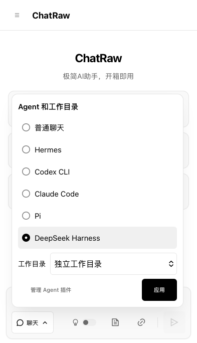

# iPhone 15 Pro 实机反馈与修复

2026-11-14，用户在 iPhone 15 Pro 的 Safari 上完成首轮检查，并提供 IMG_3431–IMG_3436 六张截图。系统/浏览器具体版本未提供。用户确认普通聊天发送正常，Agent 菜单可以选择，插件页与设置内容可操作；同时发现布局问题，因此首轮 G10 未通过；修复上线后用户已完成复验并确认通过。

## 问题与根因

|用户反馈|代码根因与修复|
|---|---|
|输入框离底部工具栏/键盘太远|手机 padding 被后面的全局 `max(40px, safe-area + 20px)` 覆盖。移除该覆盖，手机使用 `max(8px, safe-area)`；保留设备安全区。没有改动 visualViewport 同步逻辑。|
|页面左侧出现灰色竖影|关闭侧栏只平移到屏幕外，阴影仍伸入可视区域。手机关闭状态去除阴影并隐藏侧栏。|
|DeepSeek 选中条与文字不居中|手机行高 44px，内容仍从顶部排布。改为垂直居中，去掉单选框顶部偏移。|
|选择 Agent 后工作目录使菜单略需滚动|手机工作目录标签和下拉框改为同一行，收紧非交互间距；下拉框明确为 44px 高，避免 WebKit 原生 select 忽略 min-height。|
|设置页上下有灰条，插件页没有|普通设置被限制为 visualHeight-12px，插件页因更高 CSS 优先级保持全高。手机两种整页弹窗统一铺满 overlay。|
|横屏侧栏设置按钮不可达、聊天列表被挤掉|只有聊天列表允许滚动，头部/按钮/页脚总高度超过短屏。短屏手机改为整个侧栏滚动，聊天列表不压缩到零，收紧头部间距；竖屏仍保留列表独立滚动。|

## 本地浏览器证据

`scripts/test-phone-layout.mjs` 使用回环 fixture，无模型 API 请求：

- WebKit 27.2、Chromium 109.0.5414.46、Firefox 150.0.2 均通过。
- 393×684 竖屏：无安全区模拟时输入框底部 8px；单选行、文本与 radio 中心误差小于 1px；未绑定聊天选中 DeepSeek 后，包含工作目录的菜单无需滚动，下拉框点击高度至少 44px。
- 设置弹窗上下边缘与 overlay 对齐，差值 0px。
- 852×283 短横屏、12 条测试聊天：列表不压缩为零，滚动侧栏到底部后设置按钮完整可见，并能真实点击打开设置。
- 模拟键盘 visualViewport 高 360px、offsetTop 20px：输入区保持在可视范围内，不额外留下 40px 空隙。
- Chromium 109 既有 `test-agent-menu-layout.mjs` 通过，包括桌面、窄屏、短横屏、键盘焦点、菜单内部滚动和模拟键盘；vendor 校验通过。

这些是 macOS 上的真实浏览器引擎与模拟视口，不是 iPhone 原生键盘复验。用户已在新版部署后完成实机复验，确认上述问题均解决。本次只修改前端，不改模型或 Runner。

## 现场与后续验收

前端版本 8.2 已部署到 RM-01，线上三个文件与 `fcc75be` 一致。用户随后回复：“我测试了，都没问题了，都挺好的。”据此将 G10 更新为“iPhone 15 Pro Safari 实机复验通过”。系统/浏览器具体版本未提供，不外推到其他设备。用户随后报告的旧测试聊天删除保护是独立状态问题，不影响本次手机布局验收。
